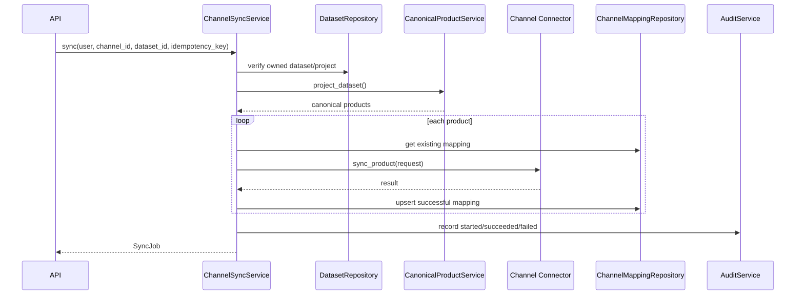

# Channel Synchronization Architecture

## Flow



## Idempotency

The synchronization service requires a non-empty idempotency_key.

An existing key for the same workspace is returned when it refers to the same channel and dataset. Reusing a key for a different channel or dataset is rejected.

Each product request receives a derived idempotency key:

```text
<sync idempotency key>:<product id>
```

## Deterministic product projection

CanonicalProductService is read-only.

It loads the owned dataset, reads the persisted source, applies column mapping and normalization, constructs canonical products, and derives deterministic product identity.

It does not mutate datasets, create ChangeSets, or persist product records.

## Sync operation selection

- 
oop when the existing mapping hash equals the desired product hash;
- update when an external product mapping exists but the desired hash differs;
- create when no external product mapping exists.

Successful attempts update the channel mapping. Failed attempts are recorded and contribute to the final job failure state.

## Audit

The service records audit events for channel sync started, succeeded and failed states.
