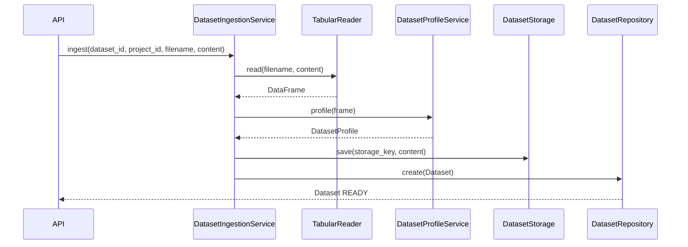

# Ingestion Architecture

## Scope

Dataset ingestion persists an uploaded tabular source and creates a `Dataset` record containing profile and source metadata.

## Flow

## Dataset metadata

The ingestion service records:

- filename;
- file format;
- size in bytes;
- SHA-256 content hash;
- storage key when persistent storage is configured;
- row count;
- column count;
- source type;
- dataset profile.

The profile includes row count, column count, duplicate row count, and per-column statistics.

## Streaming ingestion

`ingest_streaming()` persists the source through a hashing reader and then profiles the persisted source chunk by chunk.

The streaming path records the SHA-256 hash and byte count while the source is read.

## Boundary

The ingestion service delegates tabular reading, profiling, storage and dataset persistence to their respective contracts/services. It does not itself define the tabular parsing implementation.
